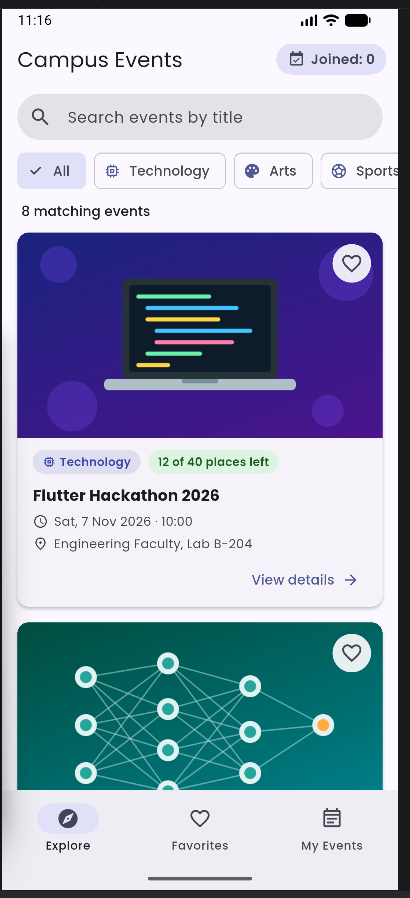
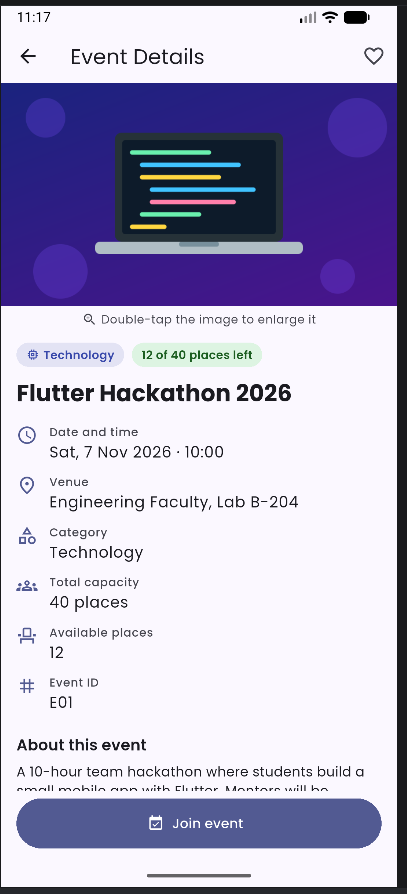
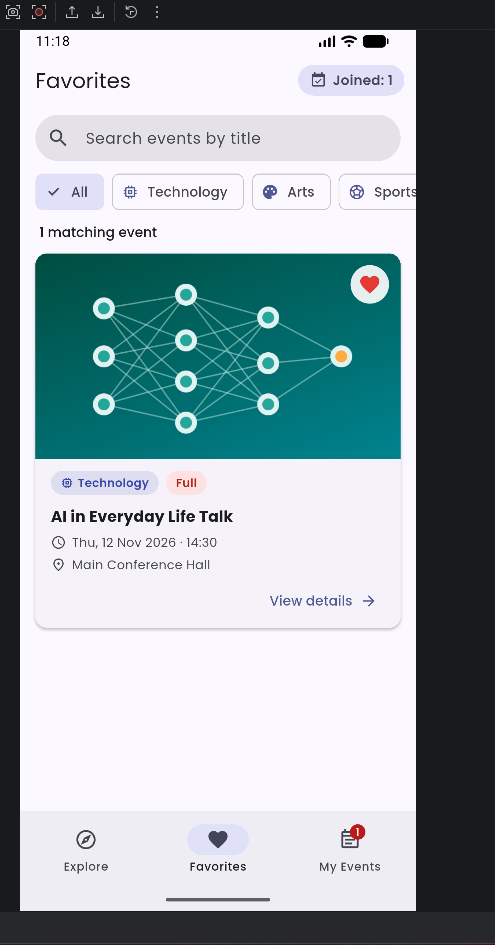
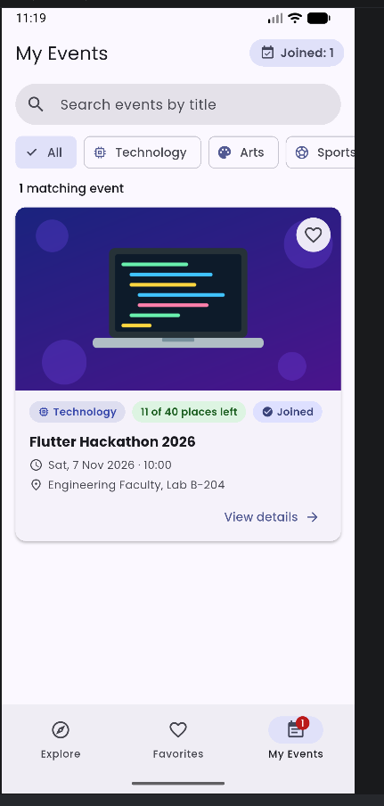
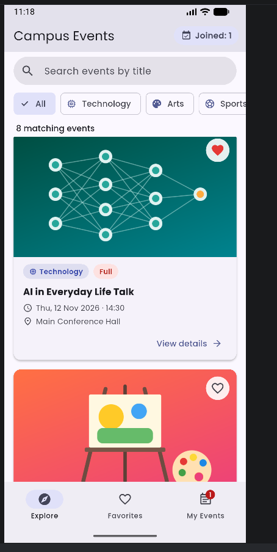
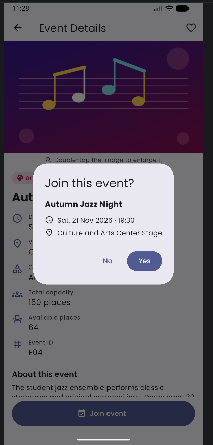
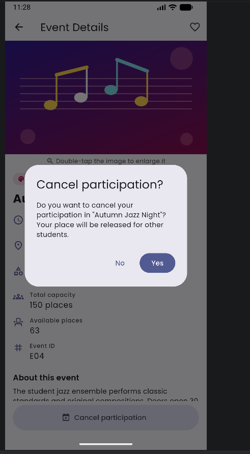

# Campus Event Explorer

**BIM493 – Mobile Programming I | Assignment #1 (2026–2027)**

A Flutter mobile application that helps students discover campus events, save
favorites and manage their own participation. All event data is fictional and
stored in Dart code, so the app works fully offline after installation.

---

## Team

| Full name | Student ID | Contribution |
|-----------|------------|--------------|
| Emre Çelik | 11923640488 | Event data model, Explore screen, search and category filter, README |
| Işıl Edis | 39376419406 | Details and image viewer screens, join/cancel logic, Favorites/My Events, tests |

---

## Flutter version

The project was built and tested with Flutter **3.47.6** on the **stable**
channel. Output of `flutter --version`:

```
Flutter 3.47.6 • channel stable • https://github.com/flutter/flutter.git
Framework • revision 5fc346839b (2 weeks ago) • 2026-09-30 15:02:49 -0700
Engine • hash b8c8d3d8d5d0095127057f8a29ca8cc53da2167c (revision 692136cb65) (17 days ago) • 2026-09-30 00:56:59.000Z
Tools • Dart 3.13.5 • DevTools 2.60.0
```

---

## Setup and run

Requirements: Flutter 3.47.6 (stable) and an Android emulator/device (or an
iOS simulator/device on macOS).

```bash
# 1. Check the Flutter version and channel
flutter --version

# 2. Get dependencies
flutter pub get

# 3. List connected devices / emulators
flutter devices

# 4. Run the app
flutter run

# Optional: static analysis and automated tests
flutter analyze
flutter test

# Optional: build an Android APK
flutter build apk --release
```

---

## Features

### 1. Event data and Explore screen
- 8 fictional events (`lib/data/sample_events.dart`) across 3 categories:
  **Technology**, **Arts** and **Sports**.
- Each event has a unique ID, title, category, date/time, venue, description,
  local image, total capacity and initial available places.
- *AI in Everyday Life Talk* (E02) is initially **full** (0 places);
  *Open Air Painting Workshop* (E03) has **exactly one** available place.
- All dates are in November–December 2026, after the assignment deadline.
- Scrollable event cards with image, title, category, date/time, venue,
  availability label, favorite (heart) button and a **View details** button
  (tapping the card also opens the details).
- 6 distinct local images (category images are reused by two events).

### 2. Search and category filter
- Title search that ignores letter case and surrounding spaces.
- **All**, **Technology**, **Arts** and **Sports** filter chips.
- Search and category work together; the number of matching events is shown.
- Readable empty-state message, with a **Clear search** button (and an `×`
  icon inside the search field).
- The same search/filter settings apply to Explore, Favorites and My Events.

### 3. Details and image viewer
- Separate **Event Details** screen showing all event information.
- **Double-tap** the image to open a full-screen image viewer (pinch to zoom).
- Normal Back navigation on both screens.
- Favorite button (app bar) and participation button (bottom) on details;
  returning to the previous screen shows the updated state.

### 4. Favorites and My Events
- Bottom navigation bar with **Explore**, **Favorites** and **My Events**.
- Favorites contains only favorited events; My Events contains only joined
  events. Both show an empty-state message when they are empty.
- Favorite changes from a card or details update all views immediately.
  Favorites never change participation or capacity.

### 5. Join and cancel participation
- **Join event** opens a confirmation dialog showing the title, date/time and
  venue with **Yes** / **No**. *No* or dismissing the dialog changes nothing.
  *Yes* joins once, decreases available places by one and shows a SnackBar.
- A joined event shows **Cancel participation** with a confirmation dialog.
  Confirming removes it from My Events and restores one place.
- Repeated joins never create duplicates or decrease capacity twice
  (`EventManager.join` refuses an already-joined event).
- An unjoined event with zero places is marked **Full** and its button is
  disabled. A student who took the last place can still cancel.
- The total number of joined events is always visible in the app bar
  (`Joined: N`) and as a badge on the My Events tab.

### 6. Layout, assets and font
- Built with `MaterialApp`, `Scaffold`, `Row`, `Column`, `Padding`,
  `Expanded`, `Wrap`, `ListView`, etc.
- Reusable `StatelessWidget`s: `EventCard`, `AvailabilityLabel`,
  `CategoryChip`, `CategoryFilterBar`, `EmptyState`, `EventSearchField`,
  `FavoriteButton`, `JoinedChip`, `JoinedCountBadge`, `ImageViewerScreen`.
- `StatefulWidget`s: `HomeScreen`, `EventDetailsScreen`.
- Simple `setState`-based updates; no state-management library.
- Images and the **Poppins** font are declared in `pubspec.yaml`; Poppins is
  bundled locally (`assets/fonts/`) and applied app-wide in `lib/app.dart`.

---

## Project structure

```
lib/
├── main.dart                     # Entry point
├── app.dart                      # MaterialApp + theme (Poppins font)
├── models/campus_event.dart      # CampusEvent model and EventCategory enum
├── data/sample_events.dart       # Fictional event data
├── logic/event_manager.dart      # Favorites, participation, capacity, filtering
├── utils/date_time_format.dart   # Date/time formatting
├── screens/
│   ├── home_screen.dart          # Explore / Favorites / My Events + search & filter
│   ├── event_details_screen.dart # Details, favorite, join / cancel
│   └── image_viewer_screen.dart  # Enlarged image
└── widgets/                      # Reusable widgets and dialogs
assets/
├── images/                       # Event images (PNG)
└── fonts/                        # Poppins TTF files + OFL.txt license
test/                             # Unit and widget tests
tool/generate_images.py           # Script that generated the event images
docs/screenshots/                 # Screenshots used in this README
```

---

## Screenshots

| Explore | Event details | Favorites | My Events |
|---------|---------------|-----------|-----------|
|  |  |  |  |

| Full event (E02) | Join dialog | Cancel dialog |
|------------------|-------------|---------------|
|  |  |  |

---

## Test checklist

| Case | How it was checked | Result |
|------|--------------------|--------|
| Full event (E02) is marked **Full** and cannot be joined | Manual + widget test *"A full event is marked Full and cannot be joined"* | [x] |
| Join dialog shows title, date/time, venue; **No**/dismiss changes nothing | Manual + widget test *"Join: No/dismiss change nothing, Yes joins the last place once"* | [x] |
| Joining the last place (E03) and cancelling it again works | Manual + unit test *"a student who took the last place can still cancel"* | [x] |
| **Cancel dialog**: *No* keeps participation, *Yes* removes it from My Events and restores one place | Manual + widget test *"Cancel participation with confirmation updates My Events"* | [x] |
| Repeated join does not create duplicates or decrease capacity twice | Unit test *"joining decreases available places by one and only once"* | [x] |
| **Empty search** shows a readable message and Clear search resets it | Manual + widget tests *"Search ignores case…"* and *"The clear icon…"* | [x] |
| Search ignores case/spaces and works together with the category filter | Manual + unit and widget tests | [x] |
| Favorites update across Explore, Favorites and details | Manual + widget test *"Favorites from a card and from details update all views"* | [x] |
| Double-tap on the details image opens the image viewer; Back works | Manual + widget test *"Double-tapping the details image opens the image viewer"* | [x] |

All automated tests pass with `flutter test` (22 tests).

---

## Asset credits

| Asset | Source | License |
|-------|--------|---------|
| Event images (`assets/images/*.png`) | Original illustrations created for this project, generated with `tool/generate_images.py` | Created by the team; no third-party content |
| Poppins font (`assets/fonts/Poppins-*.ttf`) | [Poppins](https://github.com/itfoundry/Poppins) by Indian Type Foundry, downloaded from [Google Fonts (google/fonts)](https://github.com/google/fonts/tree/main/ofl/poppins) | SIL Open Font License 1.1 – see `assets/fonts/OFL.txt` |
| Icons | Material Icons, included with Flutter (`uses-material-design: true`) | Apache License 2.0 |

---

## Known limitations

- Favorites and participation are kept in memory only; they reset when the
  app is restarted (as allowed by the assignment).
- Event data is fictional and fixed in code; there is no login, backend,
  database, real booking, GPS or phone call feature (outside the scope).
- The app has a single fixed student; capacities are not shared between
  devices.
- The UI is designed for phones in portrait orientation; only a light theme
  is provided.
